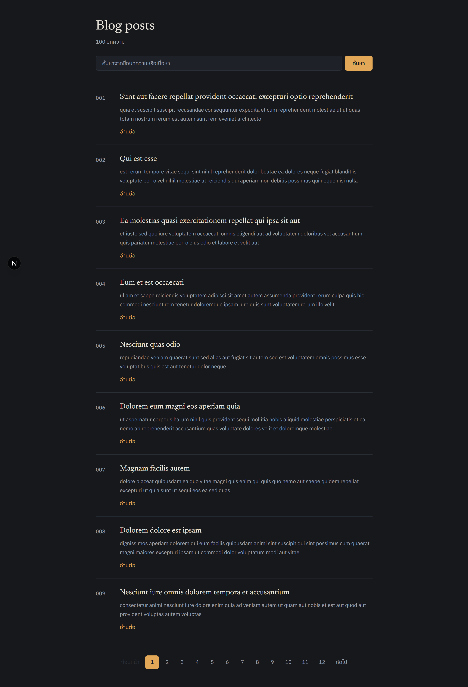
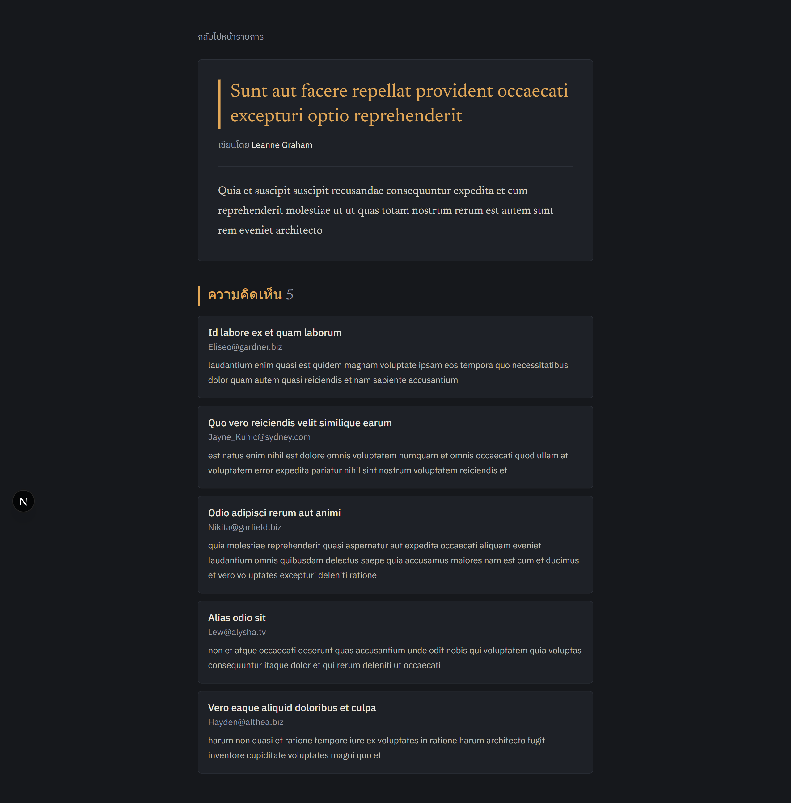
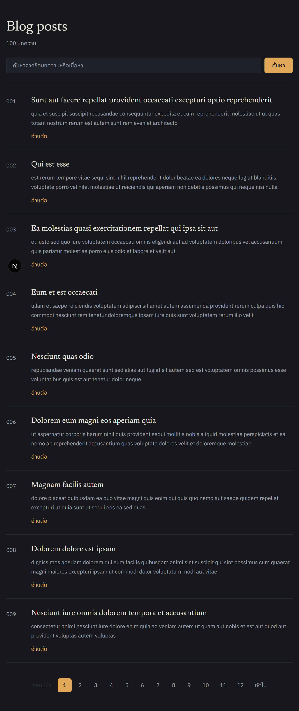
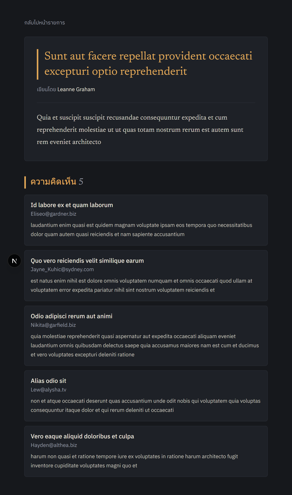
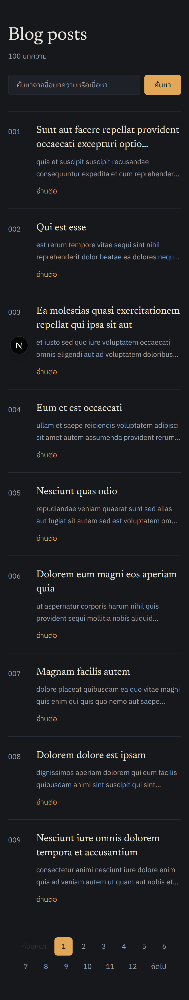
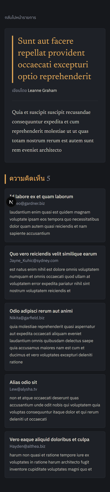

# Blog Post
Trainee Assignment #2: Blog Post Listing + Detail Page (Next.js)

เว็บแอปพลิเคชันแสดงบล็อกและบทความ 2 หน้า (หน้าแสดงรายการบทความและหน้ารายละเอียดบทความ) ดึงข้อมูลจาก [JSONPlaceholder API](https://jsonplaceholder.typicode.com/) ด้วย Axios และพัฒนาด้วย Next.js (App Router)

## Features
- **Post List (`/posts`):** แสดงรายการบทความ พร้อมหมายเลข ID (format 3 หลัก), หัวข้อบทความ (ตัดบรรทัดด้วย `line-clamp-2`), เนื้อหาย่อ และปุ่ม "อ่านต่อ"
- **Post Detail (`/posts/[id]`):** แสดงรายละเอียดบทความฉบับเต็ม พร้อมดึงข้อมูลชื่อผู้เขียน (Author) จาก API `/users/{id}` และแสดงรายการความคิดเห็นทั้งหมด (Comments)
- **Comments Section:** แสดงความคิดเห็นใต้บทความ (ชื่อผู้คอมเมนต์, อีเมล, และข้อความแสดงความคิดเห็น)
- **Search & Pagination:**
  - ค้นหาบทความจากชื่อ (Title) หรือเนื้อหา (Body) แบบ Case-insensitive ผ่าน URL Query Parameter (`?q=...`)
  - ระบบแบ่งหน้า (Pagination) หน้าละ 9 บทความ พร้อมปุ่มเปลี่ยนหน้า (ก่อนหน้า / หมายเลขหน้า / ถัดไป) ผ่าน URL Query Parameter (`?page=...`) โดยยังคงรักษาค่าคำค้นหาเดิมไว้
  - ช่องค้นหาใช้ Native Form GET ไม่เกิด Client-side JS overhead
- **Loading State:** Skeleton UI แบบ Shimmer pulse ทั้งหน้ารายการและหน้ารายละเอียด โดยคำนวณความสูงและขนาดให้ตรงกับเนื้อหาจริง
- **Error State:** แสดงหน้าจัดการข้อผิดพลาด (`error.tsx`) เมื่อ API หรือ Network ขัดข้อง พร้อมแสดงรหัสข้อผิดพลาด (`error.digest`) และปุ่ม "โหลดอีกครั้ง" (Retry) เพื่อดึงข้อมูลใหม่จาก Server
- **Not Found (404):** ตรวจสอบความถูกต้องของ ID หากไม่ใช่ตัวเลข หรือไม่พบบทความจาก API จะแสดงหน้า `not-found.tsx` พร้อมปุ่มพากลับหน้ารายการ
- **Responsive & Design System:** รองรับการแสดงผลทุกขนาดหน้าจอ (Desktop / Tablet / Mobile) ภายใต้โทนสี Dark Theme แบบ Editorial ด้วยฟอนต์ Newsreader และ IBM Plex Sans Thai
  
## Tech Stack
- **Framework:** Next.js 16 (App Router, Server Components)
- **Library:** React 19
- **Language:** TypeScript 5
- **Styling:** Tailwind CSS v4 (พร้อม `@tailwindcss/turbopack`)
- **HTTP Client:** Axios
- **Typography:** Google Fonts ผ่าน `next/font/google` (`IBM_Plex_Sans_Thai`, `Newsreader`)
- **Code Quality:** ESLint 9 (`eslint-config-next`)
  
## API
ดึงข้อมูลจำลองจาก [JSONPlaceholder](https://jsonplaceholder.typicode.com/):

| Method | Endpoint | รายละเอียดการใช้งาน |
|---|---|---|
| GET | `https://jsonplaceholder.typicode.com/posts` | ดึงรายการบทความทั้งหมด |
| GET | `https://jsonplaceholder.typicode.com/posts/{id}` | ดึงข้อมูลบทความตาม id |
| GET | `https://jsonplaceholder.typicode.com/users/{id}` | ดึงข้อมูลผู้เขียนบทความตาม userId |
| GET | `https://jsonplaceholder.typicode.com/posts/{id}/comments` | ดึงรายการความคิดเห็นทั้งหมดของบทความตาม postId |

## Getting Started
ความต้องการของระบบ: **Node.js 20 ขึ้นไป**

1. ติดตั้ง dependencies:
```bash
npm install
```
2. รันโปรเจคในโหมด Development:
```bash
npm run dev
```

3. เปิดเบราว์เซอร์ไปที่ [http://localhost:3000](http://localhost:3000) (หน้าแรก `/` จะ redirect ไปที่ `/posts` อัตโนมัติ)

คำสั่งอื่นๆ:
```bash
npm run lint    # ตรวจสอบโค้ดด้วย ESLint
npm run build   # Build สำหรับ Production
npm run start   # รันผลลัพธ์ Production Build
```

## Project Structure

```
src/
 ┣ app/
 ┃ ┣ favicon.ico
 ┃ ┣ globals.css              # กำหนดตัวแปรสี Dark theme และ Typography ด้วย Tailwind CSS v4
 ┃ ┣ layout.tsx               # Root Layout กำหนด Fonts (Newsreader, IBM Plex Sans Thai) และ metadata
 ┃ ┣ not-found.tsx            # จัดการหน้า 404 เมื่อไม่พบบทความหรือ URL ไม่ถูกต้อง
 ┃ ┣ page.tsx                 # Redirect อัตโนมัติจาก / ไป /posts
 ┃ ┗ posts/
 ┃   ┣ page.tsx               # หน้ารายการบทความ (Server Component: ดึงข้อมูล, ค้นหา, แบ่งหน้า)
 ┃   ┣ loading.tsx            # Skeleton UI ขณะโหลดหน้ารายการบทความ
 ┃   ┣ error.tsx              # Error Boundary หน้ารายการบทความ พร้อมปุ่มโหลดใหม่
 ┃   ┗ [id]/
 ┃     ┣ page.tsx             # หน้ารายละเอียดบทความ (Server Component: Post, Author, Comments)
 ┃     ┗ loading.tsx          # Skeleton UI ขณะโหลดหน้ารายละเอียดบทความ
 ┣ components/
 ┃ ┣ CommentList.tsx          # รายการความคิดเห็นใต้บทความ
 ┃ ┣ Pagination.tsx           # แถบควบคุมการแบ่งหน้า (Pagination links)
 ┃ ┣ PostCard.tsx             # การ์ดแสดงข้อมูลบทความแต่ละรายการ
 ┃ ┣ PostCardSkeleton.tsx     # Skeleton loader จำลองการ์ดบทความ
 ┃ ┣ PostDetail.tsx           # ส่วนแสดงเนื้อหาบทความและชื่อผู้เขียน
 ┃ ┣ SearchBar.tsx            # ช่องค้นหาบทความ (Native GET Form เชื่อมโยง URL query)
 ┃ ┗ Skeleton.tsx             # Helper Component สร้าง Skeleton Loading Line
 ┣ lib/
 ┃ ┗ api.ts                   # Axios instance กลาง และฟังก์ชันเรียก JSONPlaceholder API
 ┗ types/
   ┗ blog.ts                  # TypeScript Types / Interfaces (Post, User, Comment)
```

## Implementation Notes

- **Server Components & Streaming:** ใช้ React Server Components ดึงข้อมูลฝั่ง Server โดยตรง ช่วยลดขนาด JavaScript Bundle ฝั่ง Client และโหลดหน้าเว็บได้อย่างรวดเร็ว
- **Parallel Data Fetching:** ในหน้า `/posts/[id]` หลังจากได้ `userId` จากบทความหลัก จะเรียก API ข้อมูลผู้เขียน (`getUser`) และรายการความคิดเห็น (`getComments`) ไปพร้อมกันด้วย `Promise.all` เพื่อลด Network Waterfall
- **URL-based State Management:** ระบบค้นหาและระบบแบ่งหน้าทำงานผ่าน URL Search Parameters (`?q=...&page=...`) ทำให้สามารถแชร์ URL ลิงก์, ทำ Bookmark, หรือกดย้อนกลับ (Browser Back/Forward) ได้อย่างสมบูรณ์
- **Next.js 16 Compatibility:**
  - รองรับการเข้าถึง Dynamic APIs ใน Next.js 15/16 ด้วยการ `await` ค่า `params` และ `searchParams`
  - มีการใช้ `await connection()` จาก `next/server` เพื่อระบุการทำงานแบบ dynamic rendering อย่างถูกต้อง
- **Axios Instance & Error Handling:** รวมศูนย์การเรียก API ไว้ที่ `lib/api.ts` พร้อมกำหนด timeout 10 วินาที และมีฟังก์ชัน `isNotFound` เพื่อตรวจจับข้อผิดพลาด 404 แล้วส่งต่อให้ `notFound()` ของ Next.js

## Screenshots

| Post List (Desktop) | Post Detail (Desktop) |
|:---:|:---:|
|  |  |
### Tablet View
| Post List (Tablet) | Post Detail (Tablet) |
|:---:|:---:|
|  |  |
### Mobile View
| Post List (Mobile) | Post Detail (Mobile) |
|:---:|:---:|
|  |  |